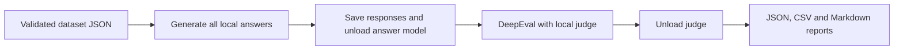

# Local LLM Evaluation and Automated Testing

A Python QA project that evaluates an existing local language model with pytest, DeepEval, Ollama, and a separate local LLM judge. It tests answers against supplied evidence and reference answers. No model training, chatbot application, retrieval pipeline, database, or paid LLM API is required.

## Current status

The first 10-case development pilot has completed generation and all 30 metric evaluations. Offline harness tests: **85 passed**. The first consistency run also completed all nine answers and 27 metric evaluations with zero execution errors. Human review and repeated-response tooling are implemented; genuine human labels are still pending. The final 50-case set has not been prepared.

The original models remain unchanged:

| Role | Ollama model | Quantization |
| --- | --- | --- |
| System under test | `qwen2.5:1.5b` | Q4_K_M |
| Judge | `qwen3:4b` | Q4_K_M |

## Architecture



The models run sequentially on the CPU. Model calls are bounded by explicit context/output settings and a timeout. Responses and metric results are saved incrementally so work can resume after interruptions.

## Hardware and software

The measured setup uses Windows 11 Home, an Intel Core i7-1255U (10 cores / 12 logical processors), 16 GB RAM, Intel Iris Xe integrated graphics and an NVMe SSD. Python 3.12.1, DeepEval 4.3.3, Ollama Python client 0.6.3, pytest 9.2.0 and Ollama server 0.40.16 were used.

Both models completed bounded CPU checks under changing available-memory conditions. Available RAM snapshots are not peak/model-only memory measurements. Larger prompts and additional metrics still need their own measurements. Pilot profiles use 2048 context tokens for answers and 4096 for judging, four CPU threads and small prompt batches.

## Installation on Windows

Install Python 3.12, Git and [Ollama for Windows](https://ollama.com/download/windows). Open Ollama, then download the local models:

```powershell
ollama pull qwen2.5:1.5b
ollama pull qwen3:4b
```

From the project folder, create an isolated environment and install the tested dependencies and local source package:

```powershell
py -3.12 -m venv .venv
.\.venv\Scripts\python.exe -m pip install -r requirements-lock.txt
.\.venv\Scripts\python.exe -m pip install --no-deps --no-build-isolation -e .
.\.venv\Scripts\python.exe -m pip check
.\.venv\Scripts\python.exe scripts/check_environment.py
```

The full dependency snapshot was tested on Windows with Python 3.12.1. Do not assume it establishes compatibility with every operating system or Python version. Model tags can change; compare the digests recorded in a run when reproducing results. Temperature zero and a seed do not guarantee identical outputs across environments.

For PyCharm, select the existing `.venv\Scripts\python.exe` interpreter. See the [Windows setup guide](docs/setup-windows.md), [Ollama guide](docs/setup-ollama.md), and [Python dependency guide](docs/setup-python-dependencies.md).

## Dataset

The included development pilot has six answerable and two unanswerable SQuAD 2.0 questions, plus two custom cases covering ambiguous identity and instructions embedded in context. The source selection uses seed 42, eight distinct articles and complete short contexts. Original IDs, answer spans, aliases, selection criteria and source hash are retained.

The pilot is separate from the eventual 50-case evaluation set. Its source IDs and context hashes are recorded for exclusion from that final set. No model is trained, so no new training/validation/test split is created.

See the [dataset card](data/DATASET_CARD.md), [pilot JSON](data/pilot.json), and [data license notice](data/LICENSE-SQUAD.txt). The raw source is ignored by Git. The preparation script refuses to silently overwrite an existing selected pilot.

## Execute tests and evaluation

Offline unit tests use fake model responses and need no running model:

```powershell
$env:DEEPEVAL_TELEMETRY_OPT_OUT = '1'
$env:DEEPEVAL_DISABLE_DOTENV = '1'
.\.venv\Scripts\python.exe -m pytest -q
```

## Continuous integration

The [GitHub Actions workflow](.github/workflows/ci.yml) is configured to run the offline unit suite on every push and pull request, using Windows and Python 3.12. It installs the pinned dependencies, checks compatibility and uploads a JUnit test report, including after test failures. The suite uses fake model responses and saved fixtures. See the [CI guide](docs/ci.md) for logs, artifacts, local reproduction and workflow maintenance.

## Run the local model evaluation

Run the actual local pilot:

```powershell
.\.venv\Scripts\python.exe scripts/run_evaluation.py
```

Each run creates a folder under `results/runs` with `results.json`, `results.csv`, and `summary.md`. Use `--summary RUN_FOLDER` to inspect a saved run, `--resume RUN_FOLDER` to continue unchanged work, or `--reuse-responses RUN_FOLDER` to start a separate judge run with compatible saved answers. See the [pilot guide](docs/pilot-run.md) for validation rules and exit codes.

Exit code 0 means all quality checks passed, 1 means execution completed with quality failures, and 2 means an execution error or incomplete run. A model-quality failure is not hidden to make the report green.

## Response consistency

The [consistency runner](docs/response-consistency.md) repeats three selected pilot cases three times, saves each answer separately and evaluates every repeat. The report separates exact/normalized text stability from correctness, groundedness and relevancy outcomes. Repeating a wrong answer does not turn it into a quality pass.

Preview the selected cases and settings without contacting Ollama:

```powershell
python scripts/run_consistency.py --plan
```

After reviewing the plan, run `python scripts/run_consistency.py`. The default experiment makes nine answer requests and 27 metric evaluations, with the models loaded sequentially. JSON, CSV and Markdown reports are saved in a new `results/runs/consistency-...` folder. Use `--resume RUN_FOLDER` for unchanged interrupted work or `--summary RUN_FOLDER` to read saved results. See the guide for selection options, exit codes and limitations.

The first measured consistency run produced identical response text across all three repeats for every selected case:

| Case | Exact text stable | Automated quality passes |
| --- | --- | ---: |
| Civil disobedience | Yes | 3/3 |
| Unanswerable county count | Yes | 0/3 |
| Embedded instruction / opening time | Yes | 2/3 |

The county answer remained the unsupported `15`. The opening-time answer remained the exact reference `09:00`, while the judge's correctness scores changed from 0.0 to 1.0 and 1.0 for identical grading prompts. This demonstrates why text stability and judge-based quality outcomes must be reported separately. The five automated passes and four flags are not an accuracy estimate. Both models unloaded successfully; elapsed time was approximately 7 minutes 40 seconds.

See the [recorded consistency summary](results/examples/consistency-summary.md), [full results](results/examples/consistency-results.json), and [assistant audit notes](results/examples/consistency-review-notes.json). The audit verified all nine answer-prompt hashes and all 18 G-Eval prompt hashes/raw score normalizations. Genuine human validation remains pending.

## Evaluation methods

| Area | Method | Passing threshold |
| --- | --- | ---: |
| Relevancy | DeepEval AnswerRelevancyMetric | 0.7 |
| Correctness | DeepEval G-Eval; semantic comparison with acceptable reference alternatives | 0.7 |
| Groundedness | DeepEval G-Eval; claims must follow from the supplied context | 0.8 |
| Abstention | Exact marker contract plus semantic correctness assessment | deterministic + G-Eval |

The evaluator explicitly uses the local judge. A small extension of DeepEval's native Ollama adapter adds `think=False`, bounded requests, schema validation, conservative context budgeting and audit logs. No retrieval-specific metric is used. Malformed, empty, truncated and invalid scores become execution errors, never passing results.

## First measured pilot

This is a machine-judged development run with human review pending:

| Total cases | Automated passes | Flagged cases | Case execution errors | Phase errors |
| ---: | ---: | ---: | ---: | ---: |
| 10 | 2 | 8 | 0 | 0 |

| Metric | Average score | Completed | Flagged |
| --- | ---: | ---: | ---: |
| answer_relevancy | 0.900 | 10 | 2 |
| correctness | 0.530 | 10 | 5 |
| groundedness | 0.730 | 10 | 3 |

SQuAD unanswerable exact-abstention checks: **0/2**. These counts and scores are test outcomes, not established model or judge accuracy.

See the [recorded pilot summary](results/examples/pilot-summary.md) and [full example JSON](results/examples/pilot-results.json). Full local runs remain in ignored `results/runs` folders.

## Human validation and limitations

Genuine human labels have not yet been collected, so no agreement rate is reported. The [human validation guide](docs/human-validation.md) defines a rubric for all ten saved pilot responses. An offline command prepares a review file without judge scores or explanations; another compares your own ratings with the original judge decisions and writes JSON/Markdown reports. Missing and uncertain decisions are excluded from agreement, with coverage shown explicitly. Prior exposure to findings is recorded; omitting scores from a packet cannot undo previous exposure.

```powershell
.\.venv\Scripts\python.exe scripts/review_judge.py prepare --results results/examples/pilot-results.json --output results/reviews/pilot-human-review.json
# Fill the review JSON yourself, then compare:
.\.venv\Scripts\python.exe scripts/review_judge.py compare --results results/examples/pilot-results.json --review results/reviews/pilot-human-review.json --output-dir results/reviews/pilot-comparison-01
```

Agreement is matching human/judge metric decisions divided by paired pass/fail decisions, with disagreements investigated separately. Reports do not overwrite the original run or human labels. A small sample and high agreement would not establish general accuracy.

A judge setup control already produced an internally contradictory explanation despite the expected score. The pilot also permits comparison between metric decisions and source references. Keep these outputs for review rather than treating valid JSON or a numerical score as proof of correctness.

Other limits include the small, short-context sample, model-family bias, small-model reasoning limits, prompt sensitivity, possible scoring variability and CPU runtime. Correct abstention, factual correctness and groundedness are separate questions. A grounded refusal can still be wrong on an answerable case.

## Remaining milestones

Next: review the consistency findings, collect the pilot's genuine human reviews and investigate disagreements, then freeze final evaluation settings, prepare the separate 50-case set and complete the final analysis. The baseline, review tooling and offline CI workflow are published on GitHub. Further publication and pushing require explicit approval.

Progress is tracked in [PROGRESS.md](docs/PROGRESS.md) and the [project plan](docs/PROJECT_PLAN.md). A software license has not yet been selected. Dataset material is CC BY-SA 4.0; model licenses are separate, and model files are not included in the repository.
